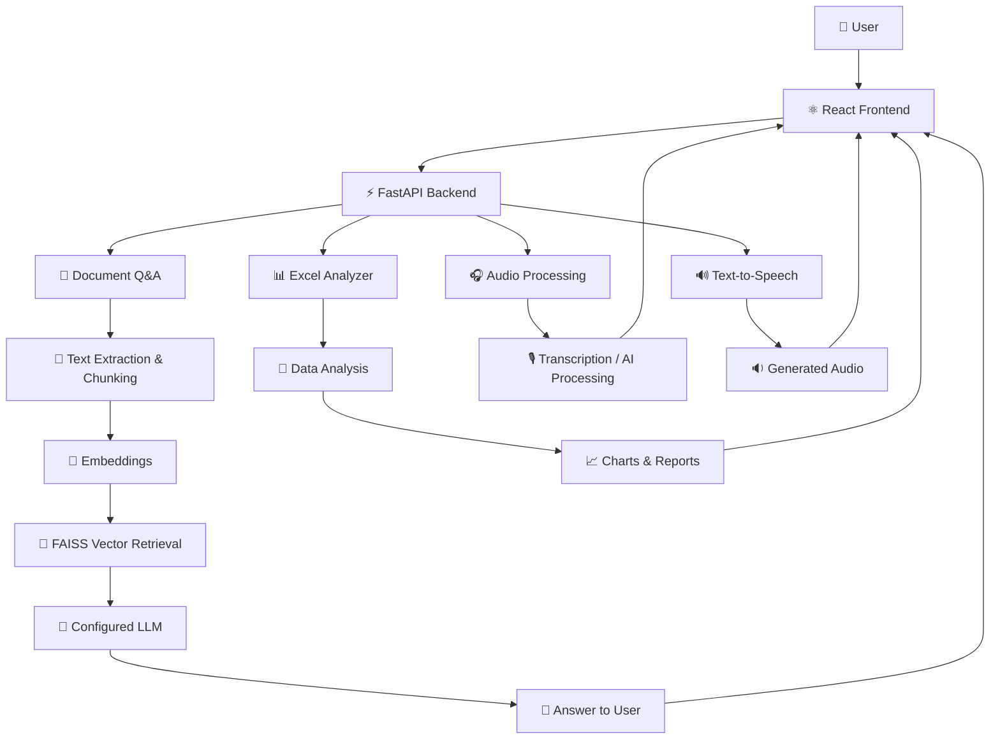

# 🤖 VoiceDocAI — Talk to Your Files

<p align="center">
  
</p>

<p align="center">
  
</p>

<p align="center">
  <b>An AI-powered document assistant combining Retrieval-Augmented Generation (RAG), intelligent spreadsheet analysis, audio processing, and text-to-speech in one web application.</b>
</p>

<p align="center">
  <a href="https://voicedocai-new.onrender.com/"></a>
  <a href="https://voicedocai-api.onrender.com/docs"></a>
  
  
</p>

---

## 🌌 About the Project

**VoiceDocAI — Talk to Your Files** is a full-stack AI application designed to make documents, spreadsheets, and audio content easier to understand.

Instead of manually searching long documents or analyzing spreadsheet data row by row, users can interact with AI-powered tools through a single interface.

The backend is built with **FastAPI**, while the frontend provides an interactive experience using **React**. The AI architecture includes technologies such as Retrieval-Augmented Generation, vector search, embeddings, and Ollama-based local language models.

### ✨ What makes VoiceDocAI different?

- 📄 **Document Intelligence:** Ask questions about uploaded documents using a RAG-based workflow.
- 📊 **Automated Excel Analytics:** Generate statistical insights and visualizations from spreadsheet data.
- 🎧 **Audio Intelligence:** Access audio transcription and AI-powered audio processing features.
- 🔊 **Text-to-Speech:** Convert supported text into playable audio.
- 🔎 **Semantic Search:** Use embeddings and vector retrieval to find relevant document information.
- 🧠 **Local AI Option:** Use Ollama with a locally configured model for privacy-focused processing.
- 🌐 **Full-Stack Architecture:** A React frontend communicates with a modular FastAPI backend.

---

## 🚀 Core Features

<table>
<tr>
<td width="50%" valign="top">

### 📚 Document Q&A

- Upload supported documents.
- Extract and process document content.
- Split content into manageable chunks.
- Generate semantic embeddings.
- Retrieve relevant content using vector search.
- Ask questions about document information.
- Generate answers using the configured language model.

**Core technologies:** RAG, FAISS, Sentence Transformers, Ollama.

</td>
<td width="50%" valign="top">

### 📈 Excel Data Analyzer

- Upload Excel spreadsheets.
- Inspect dataset dimensions.
- Identify numerical and categorical columns.
- Generate statistical insights.
- Visualize data through charts.
- Explore correlations and missing values where supported.
- Export generated chart collections and PDF reports where available.

**Core technologies:** Python, Pandas, Matplotlib, Seaborn.

</td>
</tr>
<tr>
<td width="50%" valign="top">

### 🎙️ Audio AI

- Process supported audio inputs.
- Access speech transcription functionality.
- Generate AI-assisted audio summaries or analysis where configured.
- Integrate audio processing with the application workflow.

**Core technologies:** Python and the configured audio/AI components.

</td>
<td width="50%" valign="top">

### 🔊 Text-to-Speech

- Convert supported text into speech.
- Generate audio output through the backend.
- Serve generated audio files to the frontend.
- Support a more accessible, voice-oriented experience.

**Core technologies:** FastAPI and the configured TTS engine.

</td>
</tr>
</table>

---

## 🧊 Animated Project Showcase

<p align="center">
  
</p>

<p align="center">
  <i>AI-powered workflows, intelligent data processing, and a modern developer experience.</i>
</p>

> **Showcase tip:** Replace this sample animation with a GIF or screen recording of your actual VoiceDocAI interface to make your repository more credible and distinctive.

---

## 🛠️ Technology Stack

<p align="center">
  
</p>

| Layer | Technologies | Purpose |
|---|---|---|
| Frontend | React, JavaScript, CSS | User interface and interactions |
| Backend | Python, FastAPI | API endpoints and application logic |
| Language models | Ollama, configured LLM | Local model inference where configured |
| RAG | FAISS, Sentence Transformers | Semantic retrieval and document Q&A |
| Data analysis | Pandas, NumPy | Spreadsheet processing and numerical analysis |
| Visualization | Matplotlib, Seaborn | Charts and analytical visualizations |
| Document processing | Python document-processing libraries | Extracting supported document content |
| Audio | Configured transcription and TTS components | Speech processing and audio generation |
| API communication | Axios / HTTP requests | Frontend-to-backend communication |
| Deployment | Render | Hosting the frontend and backend |

---

## 🧠 How It Works



### Document Q&A workflow

1. The user uploads a supported document.
2. The backend extracts and prepares its text.
3. The text is divided into chunks and represented through embeddings.
4. FAISS retrieves relevant content for a question.
5. The configured language model generates an answer using the retrieved context.
6. The frontend displays the result.

*Exact processing steps depend on the selected feature and its implementation.*

---

## 🌐 Live Deployment

| Component | Link |
|---|---|
| Web application | [voicedocai-new.onrender.com](https://voicedocai-new.onrender.com/) |
| Backend API | [voicedocai-api.onrender.com](https://voicedocai-api.onrender.com/) |
| Interactive API documentation | [Swagger UI](https://voicedocai-api.onrender.com/docs) |
| Health endpoint | [API Health Check](https://voicedocai-api.onrender.com/health) |

The backend exposes dedicated route groups for documents, Excel analytics, audio processing, and text-to-speech.

**Deployment note:** The hosted application depends on the availability and configuration of its Render services. Local Ollama execution is a separate deployment mode and should not be assumed to be active on the hosted backend.

---

## 📂 Project Architecture

The project separates the frontend interface from the backend API.

```text
VoiceDocAI/
│
├── backend/
│   ├── main.py
│   ├── routes/
│   │   ├── document.py
│   │   ├── excel.py
│   │   ├── audio.py
│   │   └── tts.py
│   ├── services/
│   │   ├── vector_store.py
│   │   └── excel_analyzer.py
│   ├── requirements.txt
│   └── storage/
│       ├── uploads/
│       ├── vector_db/
│       └── audio_outputs/
│
├── frontend/
│   ├── public/
│   ├── src/
│   ├── package.json
│   └── package-lock.json
│
├── .gitignore
└── README.md
```

*This is a representative structure based on the backend files and routes identified so far. Keep only the folders and filenames that actually exist in your repository.*

---

## ⚙️ Run Locally

### Prerequisites

Install the following before starting:

- Python 3.10 or another Python version compatible with your dependencies.
- Node.js and npm.
- Git.
- Ollama and a compatible model if you want to use the local-LLM configuration.

### 1. Clone the repository

```bash
git clone https://github.com/YOUR_USERNAME/YOUR_REPOSITORY.git
cd YOUR_REPOSITORY
```

Replace `YOUR_USERNAME/YOUR_REPOSITORY` with your actual GitHub repository path.

### 2. Configure the backend

```bash
cd backend

python -m venv venv
```

Activate the virtual environment on Windows:

```powershell
.\venv\Scripts\Activate.ps1
```

Install the backend dependencies:

```bash
pip install -r requirements.txt
```

Start the API:

```bash
uvicorn main:app --reload
```

The backend should be available at:

```text
http://127.0.0.1:8000
```

Open the API documentation at:

```text
http://127.0.0.1:8000/docs
```

### 3. Configure Ollama for local AI

Install Ollama from [ollama.com](https://ollama.com/) if your local configuration requires it.

For the `phi3:mini` model used in the earlier project setup, run:

```bash
ollama pull phi3:mini
```

Ensure Ollama is running and that the model name and connection settings match your backend configuration.

**Important:** Installing a model does not automatically connect it to the application. Verify that the backend's LLM integration is configured correctly.

### 4. Configure the frontend

Open a second terminal:

```bash
cd frontend
npm install
```

Set the frontend API base URL to your local backend if your application supports the `VITE_API_URL` environment variable:

```env
VITE_API_URL=http://127.0.0.1:8000
```

Place this in the frontend's `.env` file only if the frontend actually uses Vite and reads `import.meta.env.VITE_API_URL`.

Start the frontend using the script defined in `package.json`. For example:

```bash
npm start
```

Or, if the project uses Vite:

```bash
npm run dev
```

### 5. Verify the application

- Open the frontend in your browser.
- Confirm the backend is running.
- Test document upload and question answering.
- Test Excel analysis with a small spreadsheet.
- Test audio and text-to-speech features individually.

---

## 🔌 API Overview

The FastAPI application registers the following route groups.

| Endpoint / path | Purpose |
|---|---|
| `/` | Backend information and feature overview |
| `/health` | Health-check response |
| `/docs` | Interactive API documentation |
| `/doc` | Document processing and Q&A routes |
| `/excel` | Spreadsheet analysis routes |
| `/audio` | Audio processing routes |
| `/tts` | Text-to-speech routes |
| `/files/` | Static access to generated files and charts |
| `/audio-files/` | Static access to generated audio files |

For exact request formats, parameters, and supported operations, open the [live Swagger documentation](https://voicedocai-api.onrender.com/docs).

---

## 🔐 Privacy & Data Handling

Privacy is an important design goal of VoiceDocAI.

- **Local model option:** Ollama can run compatible language models on the user's own machine.
- **Local processing:** A properly configured local deployment can keep model inference on the local machine.
- **Deployment awareness:** Files uploaded to a hosted backend are processed by that hosted service, not automatically kept on the user's computer.
- **Sensitive information:** Avoid uploading confidential documents to a hosted service unless its data-handling and storage arrangements are appropriate for that information.
- **Storage management:** Uploaded documents, generated charts, vector indexes, and audio files should have appropriate retention and cleanup policies.

**Privacy depends on the deployment configuration.** A locally configured Ollama workflow can reduce external model API dependency, but it does not mean
